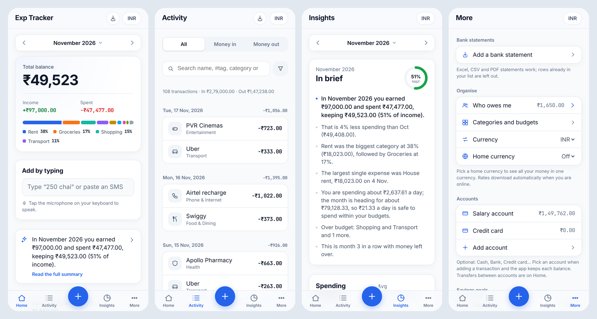
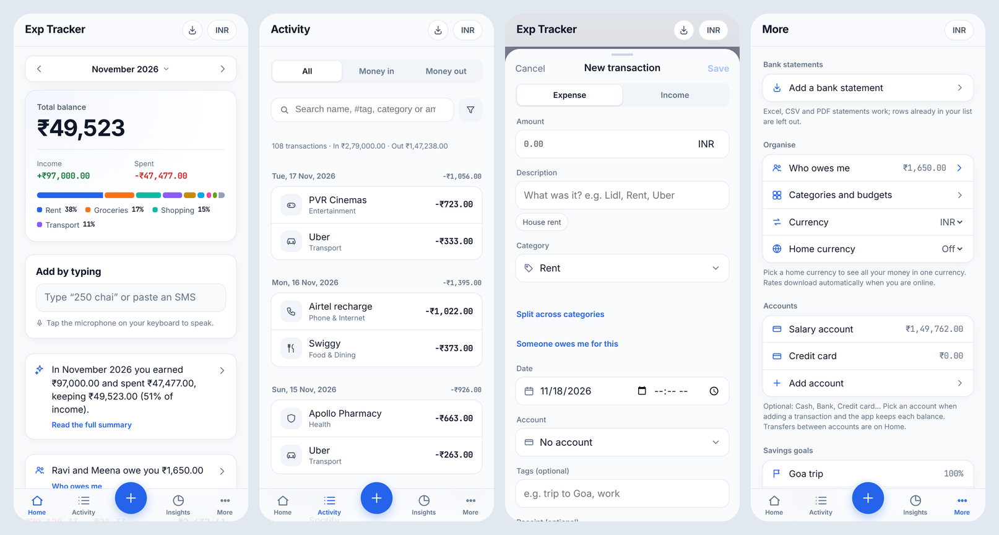
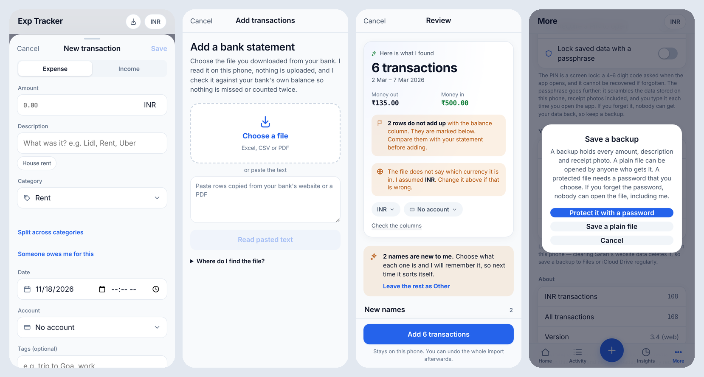
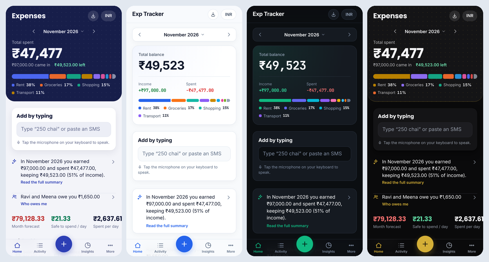
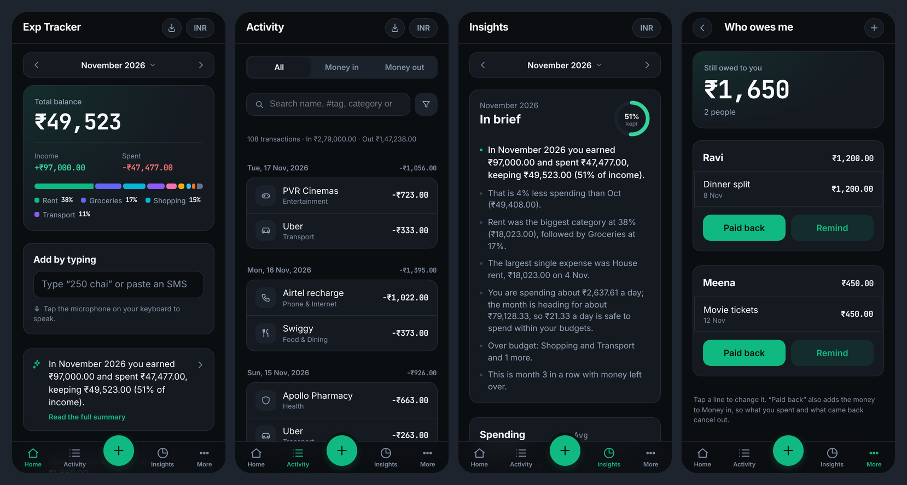

# Exp Tracker (Expense Tracker)

A personal expense tracker that runs in the phone's browser and installs like an app, on **Android** and on **iPhone**.
Everything stays on your phone. Nothing is sent anywhere, except a request for exchange rates if you choose a home currency.

Open it here: https://ashir-mansuri.github.io/expense-tracker/

*Home, Activity, Insights and More in the Alabaster and Cobalt look. All amounts in the pictures are made-up examples.*

## Contents
1. [Install it on an Android phone](#install-it-on-an-android-phone)
2. [Install it on an iPhone](#install-it-on-an-iphone)
3. [Your first five minutes](#your-first-five-minutes)
4. [The four looks](#the-four-looks)
5. [What it can do](#what-it-can-do)
6. [Backups: save, restore, move to a new phone](#backups-save-restore-move-to-a-new-phone)
7. [Keeping your data safe](#keeping-your-data-safe)
8. [Updating the app](#updating-the-app)
9. [If something goes wrong](#if-something-goes-wrong)
10. [Files and credits](#files-and-credits)

## Install it on an Android phone

Use **Chrome**. It is on almost every Android phone and installs web apps properly.

1. Open **Chrome** and go to https://ashir-mansuri.github.io/expense-tracker/ . Wait until the Home screen has fully appeared. Do this the first time with internet switched on, so the app can save itself for use without internet.
2. Tap the **three dots** (⋮) at the top right of Chrome.
3. Tap **Install app**. On some phones it says **Add to home screen** instead. If you see both, choose *Install app*.
4. A box appears. Tap **Install** (or **Add**). If your phone then asks where to put the icon, tap **Add** again, or touch and hold the icon and drop it on your home screen.
5. Go to your home screen or the app drawer and open **Expense Tracker**. It opens full screen, with no Chrome address bar. That is the installed app.
6. Optional: in More, switch on **Require a PIN to open**, and read [Backups](#backups-save-restore-move-to-a-new-phone) so you know how to save your data.

Good to know on Android
- **Samsung Internet:** open the menu, tap **Add page to**, then **Home screen**. (The names can vary a little between Samsung versions.)
- **Edge:** three dots, then **Add to phone**.
- **Firefox:** it can only add a plain shortcut, not an installed app, so use Chrome.
- On Android, Chrome and the installed app use the **same saved data**. Opening the site in Chrome later shows the same entries.
- The words on the menu depend on the phone and the Chrome version. If you cannot find *Install app*, look for *Add to home screen*.
- Your data lives inside Chrome on this phone. **Clearing Chrome's site data, or removing the app, can delete it.** Save a backup first.
- Add a **bank statement**: download it from your bank's app or website as Excel or CSV (a PDF that is not a photo also works), then in the app tap the tray icon at the top, or More, then *Add a bank statement*, and choose the file from **Downloads**.

## Install it on an iPhone

1. Open the site in **Safari** (it has to be Safari for this).
2. Tap the **Share** button (the square with an arrow).
3. Scroll down and tap **Add to Home Screen**. If you do not see it, scroll to the bottom of the sheet, tap *Edit Actions*, and switch it on.
4. Tap **Add**.
5. Open **Expense Tracker** from the home screen.

Good to know on iPhone
- An iPhone home-screen app keeps its **own separate storage**, apart from Safari. Anything you entered while using the site inside Safari does not appear in the home-screen app. To bring it over, save a backup in Safari and restore it in the home-screen app (see Backups).
- Save backups to **Files** or **iCloud Drive**.
- If you switch to the light Alabaster and Cobalt look, the clock and battery text on the iPhone turn dark the next time you close and reopen the app. Switch back to a dark look and they turn light again the same way.

## Your first five minutes

1. **Add something by typing.** On Home, in the box *Add by typing*, write `250 chai` or `paid 1,200 electricity`. The app shows what it understood underneath. Tap the **Add** button to save it.
2. **Or add your bank statement.** More, then *Add a bank statement*. Choose the file you downloaded. The app checks it against your bank's running balance, so nothing is missed or counted twice. Rows you already have are left out. One tap undoes a whole import.
3. **Look at Insights.** It writes a short summary of the month, shows where the money went, a spending calendar and your safe-to-spend amount per day.
4. **Set budgets.** More, then *Categories and budgets*.
5. **Save a backup.** More, then *Your data*, then *Save full backup*.

*Adding by hand, adding a statement, checking it before it is added, and saving a backup.*

## The four looks

More, then *Appearance and security*, then **Colours**.

| Look | What it is like |
| --- | --- |
| **Indigo** | The original. Deep indigo header. Follows your phone's light or dark setting (the *Appearance* row appears here). |
| **Alabaster & Cobalt** | Off-white background, white cards with thin borders and soft shadows, cobalt blue buttons, a frosted top bar that stays in place as you scroll, and a **Total balance** card on Home. Always light. On Home the top bar says *Exp Tracker*. |
| **Obsidian & Emerald** | New in 3.5. A dark, bank-style look: near-black blue background, charcoal cards with thin borders instead of shadows, emerald green buttons, a frosted top bar and a **Total balance** card with a soft green glow. Always dark. |
| **Gold** | Dark with gold highlights. |

About the Cobalt look
- **Total balance** is the month's income minus its spending. It shows only when the month has income. Otherwise the card says *Total spent*, as in the other looks.
- Amounts use a fixed-width style (JetBrains Mono) with equal-width digits, so numbers line up in columns.
- Money in is green, money out is red. Small green text uses a slightly deeper green so it stays easy to read.
- The chart colours are cobalt, coral, teal, violet, amber, sky, pink and olive. The order is chosen so neighbouring colours stay easy to tell apart, also for people with colour-blindness.
- The fonts are bundled inside the app (Inter and JetBrains Mono), so it looks the same offline.

About the Obsidian look

*The Obsidian and Emerald look. Made-up amounts.*

- It stays dark even if your phone is set to light. That is why there is no *Appearance* row here.
- **Total balance** works as in the Cobalt look: income minus spending, shown when the month has income. It sits on a card with a soft emerald glow, and the number shrinks a little if it is very large so it always fits.
- Buttons and the **+** are emerald with near-black writing. White writing on that green is too faint to read.
- Money in is mint green and money out is soft coral red. In the *Last 6 months* chart, the spending bars are coral too, so they are never mistaken for money in.
- The chart colours are emerald, indigo, cyan, violet, pink, yellow, sky blue and orange. Indigo and violet are very alike, so they are kept apart in the order.
- Text is set in Inter. Every amount is set in JetBrains Mono. That font has no rupee sign, so the ₹ itself is drawn in Inter.
- The top bar is frosted glass with a thin line under it and stays in place as you scroll.

## What it can do
- **Bank statements** (Excel, CSV, PDF or pasted text). A small helper on the phone reads the file, checks it against the bank's running balance, groups rows by payee, learns the names you teach it, skips rows you already have, and can undo the whole import.
- **Add by typing:** write or dictate "250 chai", or paste a bank SMS ("debited by ... to ..."). The app works out amount, name, date and category on the phone, shows you what it understood, and adds it when you tap. No internet and no outside service is used.
- **Who owes me:** "lent Ravi 500", "split dinner 1200 with Ravi and Meena", "Ravi paid back 300". It keeps the list, marks it off when they pay (also partly), spots a matching payment in your list, and can draft a reminder.
- **Budgets** with optional rollover, **recurring entries**, written insights, month forecast and safe-to-spend, alerts for unusual spending, repeating-payment detection, savings goals, upcoming bills.
- **Accounts** with transfers, split transactions, tags, receipt photos, one home currency with daily rates.
- **Reports and exports:** year in review, monthly report (on Insights, *View report*, then *Share / Save as PDF*; choose **Save as PDF** as the printer), Excel and CSV export, full backup and restore.
- **Privacy:** PIN lock, optional passphrase that scrambles the saved data, password-protected backups.

## Backups: save, restore, move to a new phone

Your data lives only in this browser on this phone. A backup file is your safety net.

**Save a backup**
1. More, then *Your data*, then **Save full backup**.
2. Choose **Protect it with a password** (recommended) or **Save a plain file**. A plain file can be opened by anyone who gets it. A forgotten password cannot be recovered.
3. **Android:** the file goes to your **Downloads** folder and Chrome shows a "Download complete" notice. Open **Files by Google**, go to *Downloads*, tap the file, and use *Share* or *Save to Drive* to keep a copy in the cloud.
4. **iPhone:** Safari saves the file and the app reminds you to use **Save to Files**. Open the file, tap Share, then *Save to Files*, and choose iCloud Drive.

**Restore a backup**
1. More, then *Your data*, then **Restore from backup**.
2. Choose the file (on Android look in *Downloads*, on iPhone in *Files*).
3. If the file has a password, type it. The app checks the file row by row and tells you if anything was left out.

**Move to a new phone, or from iPhone to Android (or back):** save a backup on the old phone, send it to yourself (Drive, iCloud, email), install the app on the new phone, then restore it there.

Do this regularly. The app reminds you when it has been a while.

## Keeping your data safe
- Backups can be saved with a password (AES-256, made in the browser). A plain backup, a CSV and an Excel file are readable by anyone who gets them, and the app says so before saving.
- More, then *Lock saved data with a passphrase* (off by default) scrambles the data stored on the phone, receipt photos included. The passphrase is asked each time the app opens. If it is forgotten the data cannot be recovered, so keep a backup.
- The **PIN** is a screen lock (4 to 6 digits). It is not encryption, and it cannot be recovered if forgotten.
- A restored backup is checked row by row. Damaged rows are left out and counted.
- Text in CSV files that starts with = + - or @ is saved with a leading apostrophe so a spreadsheet never runs it as a formula.
- If the saved data on the phone cannot be read, a copy is put aside, a banner offers to save it to a file, and nothing is overwritten.
- Anything still waiting to be saved is written when the app is closed or sent to the background.
- A statement whose rows do not add up to the bank's balance column asks for a second confirmation before anything is added.
- Possible repeats are only matched when the bank references agree, or when neither side has one.
- The page carries a Content Security Policy that allows only the app's own files and the two exchange-rate services. (GitHub Pages cannot send headers, so the policy is set in the page itself.)

## Updating the app
The app lives in the GitHub repository `ashir-mansuri/expense-tracker`, shown on the web through GitHub Pages.

1. On github.com open the repository, then **Add file**, then **Upload files**.
2. Drag in the new or changed files from the zip (all files go in the one flat folder, with no subfolders). Keep the same file names; GitHub replaces the old ones.
3. Tap **Commit changes**. Wait a minute or two for GitHub Pages to publish.
4. On the phone, open the app **twice** (close it fully between the two). The first open fetches the new files, the second shows them. *More*, at the bottom, shows the version number.

## If something goes wrong
- **The app still shows the old version.** Close it completely (swipe it away) and open it again, twice. On Android you can also open the site in Chrome and pull down to refresh.
- **My entries disappeared.** First check you are in the same place you used before. On iPhone, Safari and the home-screen app do not share data. Then restore your latest backup.
- **No "Install app" in Chrome.** Look for *Add to home screen*. Make sure the page has fully loaded, and that you are in Chrome rather than inside another app's built-in browser.
- **The file will not import.** Use the Excel or CSV version of the statement from your bank. A PDF that is a photo of a page cannot be read.
- **I forgot the passphrase or the backup password.** It cannot be recovered. That is what keeps the data private.
- **The Cobalt and Obsidian looks have no Appearance row.** Correct. Cobalt is always light and Obsidian is always dark. Choose Indigo to pick light, dark or match-my-phone.

## Files and credits
Everything sits in one flat folder, so it can be uploaded to GitHub with *Add file, Upload files*.

| File | What it is |
| --- | --- |
| `index.html`, `app.js`, `app.css` | The app and its look |
| `store.js`, `schema.js`, `vault.js` | Saving, checking backups, passphrase lock |
| `entry.js`, `quick.js`, `owed.js` | Add by typing, SMS reading, who-owes-me |
| `importui.js`, `statement.js`, `reader.js`, `xlsx.js` | Bank statement import |
| `analytics.js`, `charts.js`, `categorize.js`, `rates.js`, `receipts.js`, `sheets.js`, `icons.js` | Insights, charts, categories, exchange rates, receipt photos, bottom sheets, icons |
| `prepaint.js` | Sets the colours before the first paint so there is no flash |
| `sw.js` | Lets the app work without internet. Its version is `et-v13`; raise it whenever any file changes so phones pick up the new copy |
| `manifest.webmanifest`, `icon-*.png`, `apple-touch-icon.png` | What the phone needs to install it |
| `display-500.woff`, `display-700.woff` | Fonts for the Indigo and Gold looks |
| `inter-400.woff` to `inter-700.woff`, `inter-license.txt` | Inter, the text font of the Cobalt and Obsidian looks |
| `jetbrains-mono-400.woff`, `jetbrains-mono-700.woff`, `jetbrains-mono-license.txt` | JetBrains Mono, the font for amounts in the Cobalt and Obsidian looks |
| `readme-*.png` | The pictures in this file |
| `pdf.min.mjs`, `pdf.worker.min.mjs` | pdf.js, used only to read text PDFs on the phone |

Credits: pdf.js 6.2.108 by Mozilla (Apache License 2.0, https://github.com/mozilla/pdf.js). Inter by Rasmus Andersson and The Inter Project Authors (SIL Open Font License 1.1, see `inter-license.txt`). JetBrains Mono by JetBrains (SIL Open Font License 1.1, see `jetbrains-mono-license.txt`). Everything else is original to this project.

Version 3.5.2 (web). Fixes on the iPhone home-screen app: the Cancel and Save buttons on the Edit and New transaction screens could not be tapped in the Cobalt and Obsidian looks, and the Close and Open in Safari buttons of the monthly and yearly reports sat under the notch. The large Obsidian balance now has tighter commas.
